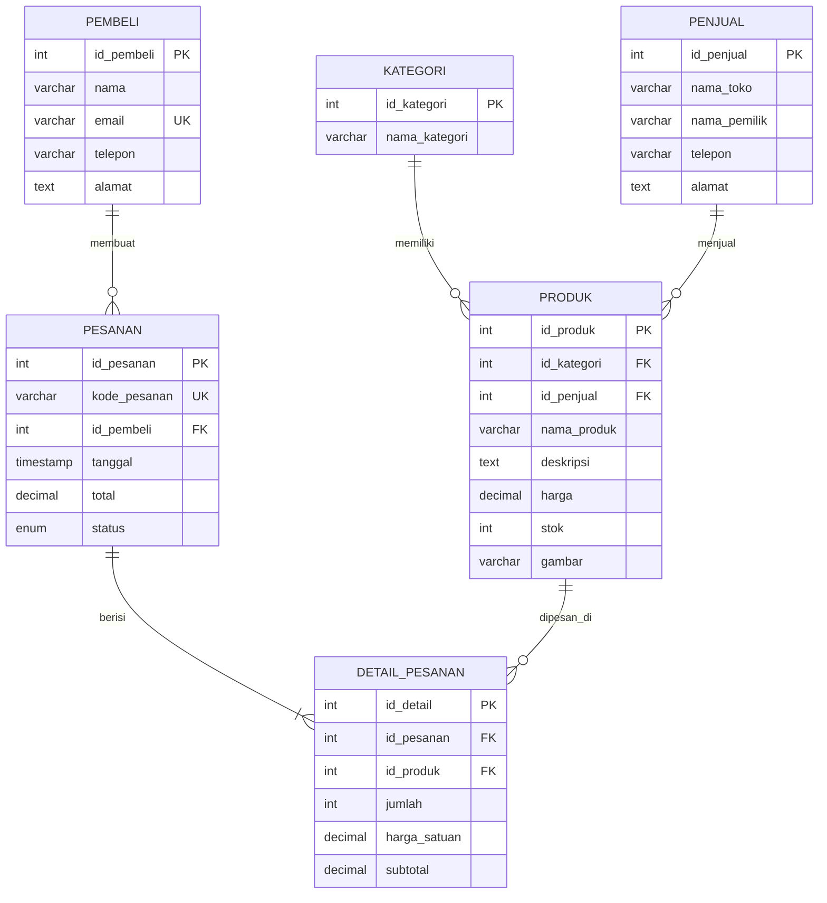
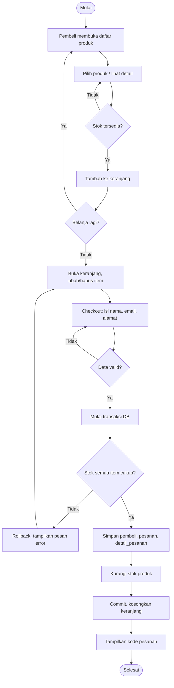

# Dokumen Perancangan — Web Marketplace Tradisional (Soal 11)

## a. Entitas
| No | Entitas | Keterangan |
|----|---------|------------|
| 1 | **kategori** | Pengelompokan produk (sayur & buah, bumbu, kerajinan, dst.) |
| 2 | **penjual** | Toko/penjual yang menawarkan produk |
| 3 | **produk** | Barang yang dijual |
| 4 | **pembeli** | Orang yang melakukan pemesanan |
| 5 | **pesanan** | Header transaksi (kode, tanggal, total, status) |
| 6 | **detail_pesanan** | Rincian produk pada tiap pesanan |
| 7 | **admin** | Pengelola yang login untuk CRUD produk & mengelola pesanan |

## b. Rancangan Database Relasional
**kategori** (PK `id_kategori`) — nama_kategori

**penjual** (PK `id_penjual`) — nama_toko, nama_pemilik, telepon, alamat

**produk** (PK `id_produk`; FK `id_kategori` → kategori, FK `id_penjual` → penjual) — nama_produk, deskripsi, harga, stok, gambar, created_at

**pembeli** (PK `id_pembeli`; `email` UNIQUE) — nama, email, telepon, alamat

**pesanan** (PK `id_pesanan`; `kode_pesanan` UNIQUE; FK `id_pembeli` → pembeli) — tanggal, total, status (baru/diproses/dikirim/selesai/batal), catatan

**detail_pesanan** (PK `id_detail`; FK `id_pesanan` → pesanan, FK `id_produk` → produk) — jumlah, harga_satuan, subtotal

**admin** (PK `id_admin`; `username` UNIQUE) — password_hash

Hubungan antar-tabel:
- kategori **1 : N** produk
- penjual **1 : N** produk
- pembeli **1 : N** pesanan
- pesanan **1 : N** detail_pesanan
- produk **1 : N** detail_pesanan (relasi **M : N** pesanan–produk dipecah lewat `detail_pesanan`)

`harga_satuan` disimpan di detail agar riwayat pesanan tidak berubah saat harga produk diubah.

## c. ERD

> Cara membuat gambar: tempel blok di atas ke https://mermaid.live lalu ekspor PNG untuk laporan.
> (Tabel `admin` berdiri sendiri, tanpa relasi, jadi tidak digambar.)

## d. Alur Proses Transaksi


## e. Mockup UI (wireframe)

**Daftar produk**
```
+--------------------------------------------------------------+
| Pasar Online Bengkulu              [Keranjang (2)] [Login]   |
+--------------------------------------------------------------+
| [ Cari produk...            ] [ Semua kategori v ] [ Cari ]  |
|                                                              |
| +-------------+  +-------------+  +-------------+            |
| |   gambar    |  |   gambar    |  |   gambar    |            |
| | [Kategori]  |  | [Kategori]  |  | [Kategori]  |            |
| | Nama produk |  | Nama produk |  | Nama produk |            |
| | Nama toko   |  | Nama toko   |  | Nama toko   |            |
| | Rp 25.000   |  | Rp 30.000   |  | Rp 18.000   |            |
| |[Detail][+K] |  |[Detail][+K] |  |[Detail][+K] |            |
| +-------------+  +-------------+  +-------------+            |
+--------------------------------------------------------------+
```
**Detail produk**
```
+--------------------------------------------------------------+
| < Kembali ke daftar                                          |
| +------------------+   [Kategori]                            |
| |                  |   Nama Produk                           |
| |     gambar       |   Rp 25.000                             |
| |                  |   Deskripsi produk ...                  |
| +------------------+   Penjual: Toko Tani Makmur             |
|                        Stok: 40                              |
|                        [ 1 ] [Tambah ke Keranjang]          |
+--------------------------------------------------------------+
```
**Keranjang belanja**
```
+--------------------------------------------------------------+
| Keranjang Belanja                                            |
| Produk          Harga      Jumlah      Subtotal              |
| Pisang Kepok    Rp 25.000  [2][OK]     Rp 50.000   [Hapus]   |
| Lada Hitam      Rp 22.000  [1][OK]     Rp 22.000   [Hapus]   |
|                              Total     Rp 72.000             |
| [Lanjut Belanja]                         [Checkout]          |
+--------------------------------------------------------------+
```
